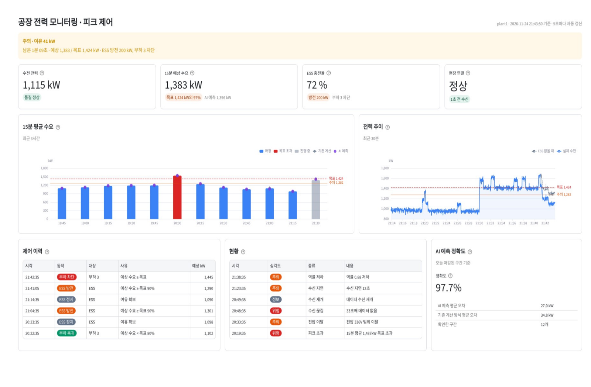
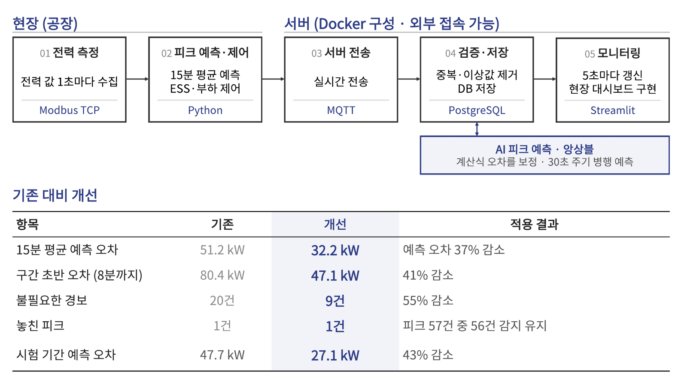

# main-peak-demand-forecast

공장 전력 피크 제어 시스템 (전력 수집·적재 자동화 + AI 피크 예측)

<br/>



<br/><br/>

## Object

<br/>

- 15분 평균 전력(최대수요전력)이 기본요금을 결정함
- 구간 종료 전 15분 평균을 예측해 ESS 방전·부하 차단으로 피크 억제
- 공개 데이터 KIT HIPE를 가상 계측기(Modbus)로 1초마다 재생
- 기존 계산식에 ML 앙상블로 오차를 보정하는 방식

<br/><br/>

## Content

<br/>

1. 시스템 구성

2. 결과

3. 폴더 구성

4. 실행 방법

5. 모델

<br/><br/>

## 1. 시스템 구성

<br/>



<br/>

- 엣지 : 15분 예상 수요 계산 후 ESS·부하 제어
  - 목표 90% 이상 ESS 방전, 목표 이상 부하 차단, 80% 미만 복귀
  - MQTT 끊김 시 SQLite에 저장 후 재전송
- 서버 : MQTT 수신 → 데이터 검사 → PostgreSQL 적재
  - 검사 : 중복, 수신 지연, 전압·주파수·역률 이탈, 전력량 역행
- 대시보드 : Streamlit, 5초마다 갱신
- ML 서빙 : 30초마다 예측 기록, 구간 종료 후 계산식과 비교
- 이상 상황 재현 : `scenario.py peak` (+450kW, 8분) / `sag` (-13%, 1분)

<br/><br/>

## 2. 결과

<br/>

| 항목 | 기존 계산식 | 앙상블 보정 | 변화 |
|---|---|---|---|
| 15분 평균 예측 오차 | 51.2 kW | 32.2 kW | 37% 감소 |
| 구간 초반 오차 (8분까지) | 80.4 kW | 47.1 kW | 41% 감소 |
| 불필요한 경보 | 20건 | 9건 | 55% 감소 |
| 놓친 피크 | 1건 | 1건 | 57건 중 56건 감지 |
| 시험 기간 예측 오차 | 47.7 kW | 27.1 kW | 43% 감소 |

<br/>

- valid 기간 기준 (마지막 줄만 test 기간)
- 경보는 절반 이하로 감소, 놓친 피크 수는 그대로
- test 기간(12월 말)은 연휴라 피크가 거의 없어 valid 기준 사용

<br/><br/>

## 3. 폴더 구성

<br/>

```
main-peak-demand-forecast/
├── config.py              전체 경로 · 설정값 · 로그
├── run_all.py             01 ~ 03 단계 순서대로 실행
├── common/                학습·서빙 공용 특징 · 모델 정의
├── 01_데이터관리/          HIPE zip → 기기별 parquet
├── 02_데이터분석/          통계 · 이상치 · 누락 → 엑셀
├── 03_전처리_모델학습/     특징 생성 · 분할 · 학습 · 앙상블
├── output/                01 ~ 03 단계 산출물 · 로그
└── 04_시뮬레이션/          계측기 · 제어기 · 서빙 · 서버(docker-compose)
```

- 파일명 `<이름>_<생성시간>`, 다음 단계는 최신 파일을 자동으로 읽음

<br/><br/>

## 4. 실행 방법

<br/>

- 데이터셋 : [HIPE (KIT)](https://www.energystatusdata.kit.edu/hipe.php), 원본 약 1.3 GB라 저장소 미포함
- [HIPE 3개월분 zip](https://bwsyncandshare.kit.edu/s/JacGftzBH85dgGK/download?path=%2F&files=hipe_cleaned_v1.0.1_geq_2017-10-01_lt_2018-01-01.zip) 을 압축 해제 없이 `01_데이터관리/raw/` 에 저장
- 각 폴더의 `.env.example` 을 `.env` 로 복사 후 작성

<br/>

```bash
pip install -r requirements.txt
pip install torch --index-url https://download.pytorch.org/whl/cpu
python run_all.py              # 01 ~ 03 단계 (중간부터 : run_all.py 3)
./04_시뮬레이션/run.sh          # 시뮬레이션 (종료 : run.sh stop)
```

- 대시보드 : http://localhost:8501

<br/><br/>

## 5. 모델

<br/>

- 학습 대상 : 실제 15분 평균 - 기준 계산식 (잔차)
- 최종 예측 : 기준 계산식 + 예측 잔차

<br/>

| 모델 | 근거 논문 |
|---|---|
| Ridge | Hoerl & Kennard (1970) |
| Random Forest | Breiman (2001) |
| XGBoost | Chen & Guestrin (2016) |
| LightGBM | Ke et al. (2017) |
| GRU | Cho et al. (2014) |
| 1D-CNN | Bai, Kolter & Koltun (2018) |
| Optuna (TPE) | Akiba et al. (2019) |
| 가중 평균 앙상블 | Bates & Granger (1969) |

<br/>

- 트리·선형 : 경과율, 누적 사용량, 최근 평균·기울기 등 요약 특징
- GRU·1D-CNN : 최근 10분 시퀀스 (10초 평균 60칸)
- 예측 시점 : 구간 2분 후 ~ 14분, 1분 간격
- 분할 : 현지 날짜 기준 70 / 15 / 15

<br/><br/>

## Feedback

<br/>

- 공개 데이터 재생이라 실제 통신 지연은 시나리오로만 재현
- 현재 ML 예측은 기록·비교만 하는 그림자 운영
- 다음 단계 : ML 예측을 제어 판단에 반영
